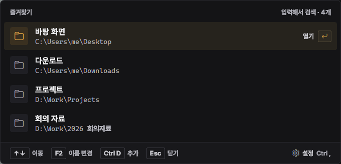
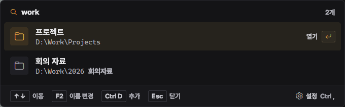
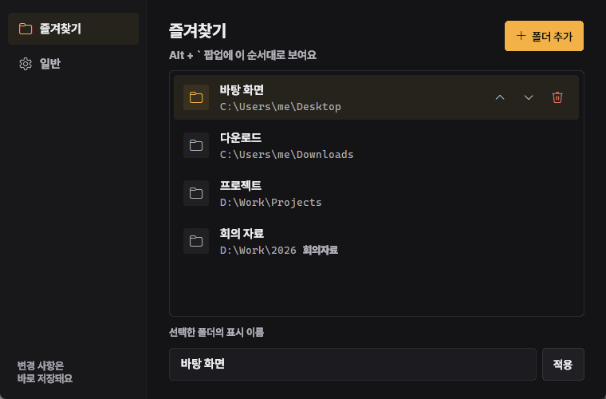
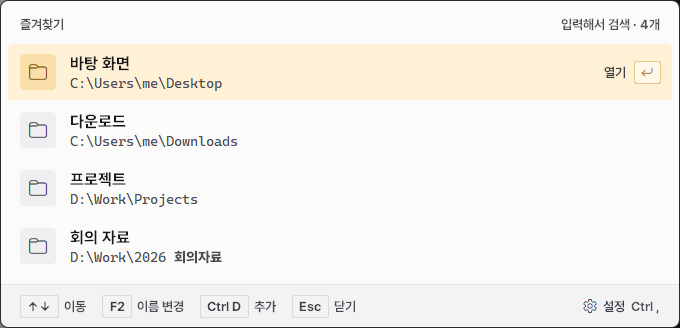

# 폴더 바로가기 (Folder Jumper)

**어디서든 `Alt` + `` ` `` 한 번으로 자주 가는 폴더를 바로 여는 윈도우용 런처**예요.
즐겨찾기한 폴더를 이름으로 찾아 `Enter`만 누르면 탐색기가 열려요.



## 다운로드

**[⬇ FolderJumper.exe 받기](https://github.com/zias7039/folder-jumper/releases/latest/download/FolderJumper.exe)** (윈도우 10/11, 설치 없이 바로 실행)

1. 위 링크로 `FolderJumper.exe`를 받아 원하는 곳(예: 바탕 화면, `문서`)에 두세요.
2. 더블클릭해서 실행하세요. 처음 실행하면 사용법 안내가 한 번 떠요.
3. 이후로는 **`Alt` + `` ` ``** (숫자 1 왼쪽 키)를 누르면 어디서든 창이 열려요.

> **"Windows의 PC 보호" 파란 창이 뜨면**: 서명(유료 인증서)이 없는 개인 프로그램이라 처음에 이런 경고가 나와요.
> **추가 정보 → 실행**을 누르면 돼요. 백신이 오진할 때도 있는데, 걱정되면 아래 [직접 빌드하기](#직접-빌드하기)로 소스에서 만들어 쓸 수 있어요.

## 사용법

실행해도 화면에는 아무것도 뜨지 않고, 뒤에서 조용히 기다려요. 단축키를 누르면 창이 열려요.

| 키 | 동작 |
|---|---|
| `Alt` + `` ` `` | 창 열기 / 닫기 (설정에서 바꿀 수 있어요) |
| 글자 입력 | 즐겨찾기를 이름·경로로 검색 |
| `↑` `↓` / 마우스 | 폴더 고르기 |
| `Enter` / 클릭 | 탐색기로 열기 |
| `F2` | 고른 폴더의 표시 이름 바꾸기 |
| `Ctrl` + `V` | 경로 붙여넣기 → 그 폴더 열기 또는 즐겨찾기에 추가 |
| `Ctrl` + `D` | 즐겨찾기 추가 (경로를 입력해 두었으면 그 경로, 아니면 폴더 선택 창) |
| `Esc` | 입력 지우기 → 한 번 더 누르면 창 닫기 |
| `Ctrl` + `,` | 설정 열기 |
| `Ctrl` + `Q` | 프로그램 종료 |



## 설정

팝업 오른쪽 아래 **⚙ 설정** 또는 `Ctrl` + `,`로 열어요. 바꾼 내용은 바로 저장돼요.

- **즐겨찾기**: 폴더 추가·삭제, 순서 바꾸기, 표시 이름 바꾸기
- **단축키**: [변경]을 누르고 원하는 키 조합을 누르면 바로 적용돼요
- **테마**: 다크 / 라이트
- **윈도우 시작 시 자동 실행**: 켜 두면 로그인할 때 자동으로 실행돼요

| 즐겨찾기 | 일반 |
|---|---|
|  |  |

라이트 테마:



## 설정 파일과 제거

- 설정과 즐겨찾기는 `%APPDATA%\FolderJumper\settings.json`에 저장돼요.
- 지우려면 설정에서 **자동 실행을 끄고**, `Ctrl` + `Q`로 종료한 뒤 `FolderJumper.exe`와 `%APPDATA%\FolderJumper` 폴더를 지우면 끝이에요.

## 글꼴

[Pretendard](https://github.com/orioncactus/pretendard) 글꼴을 써요 (SIL Open Font License 1.1).
PC에 설치돼 있지 않으면 처음 실행할 때 공식 저장소에서 `Pretendard-Bold.otf`(약 1.5MB) 한 개를 받아
`%APPDATA%\FolderJumper\fonts`에 두고, 이 프로그램 안에서만 써요. 인터넷이 없으면 맑은 고딕으로 보여요.

## 직접 빌드하기

Python 3.10 이상이 필요해요 (3.11에서 테스트). 다른 패키지 없이 표준 라이브러리만 써요.

```bash
# 소스로 바로 실행 (설정은 스크립트 옆 settings.json에 저장돼요)
pythonw folder_jump.pyw

# exe 만들기
pip install pyinstaller
pyinstaller --onefile --noconsole --name FolderJumper --icon icon.ico --add-data "icon.ico;." folder_jump.pyw
```

`dist\FolderJumper.exe`가 만들어져요.

## 라이선스

[MIT](LICENSE)
